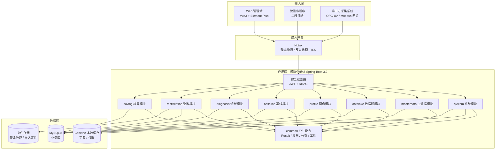
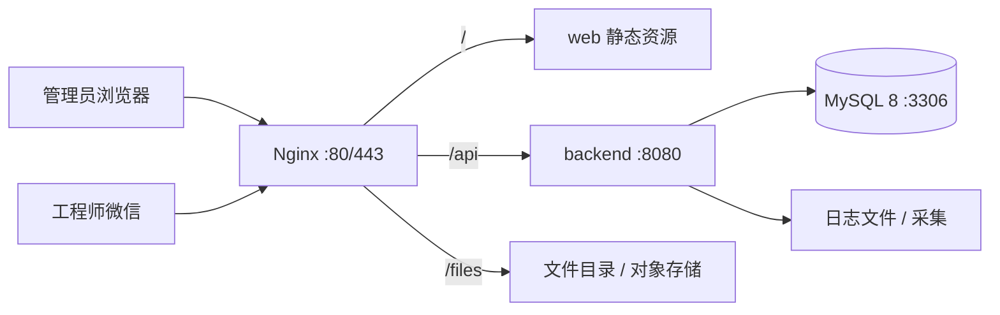
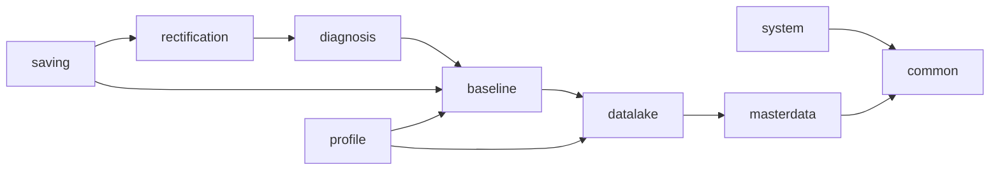
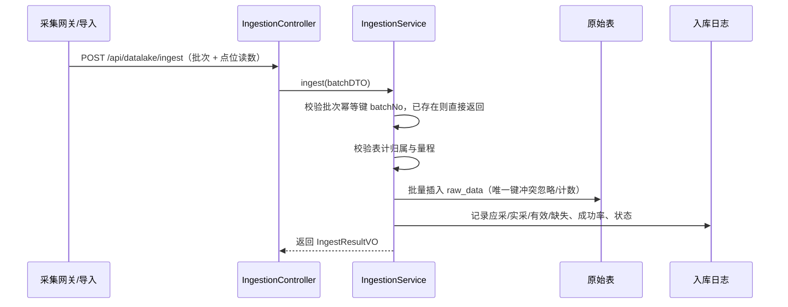
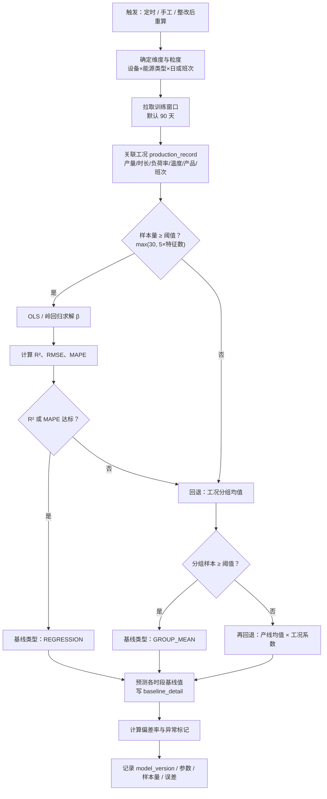
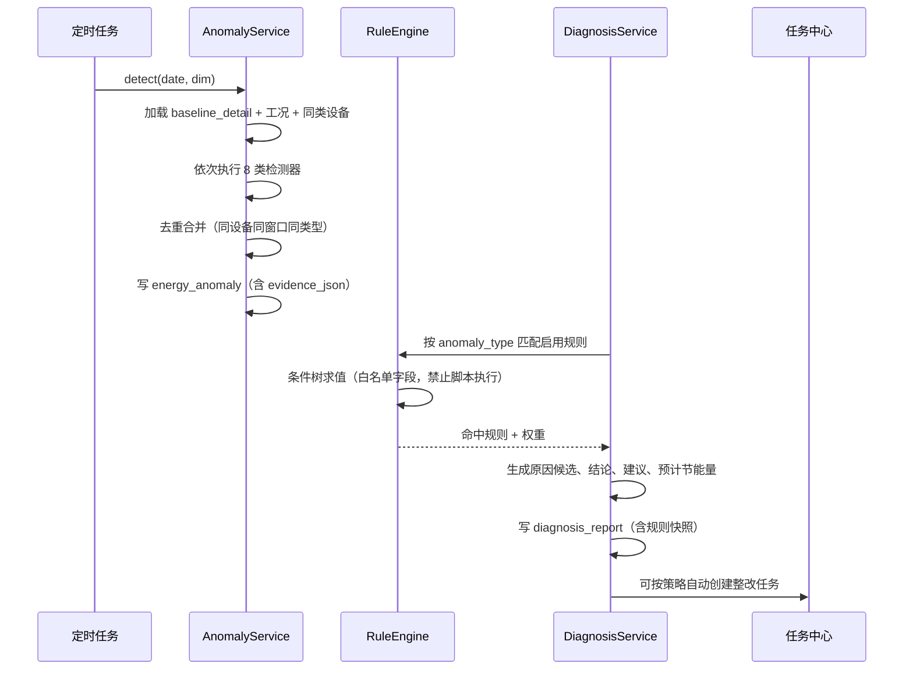
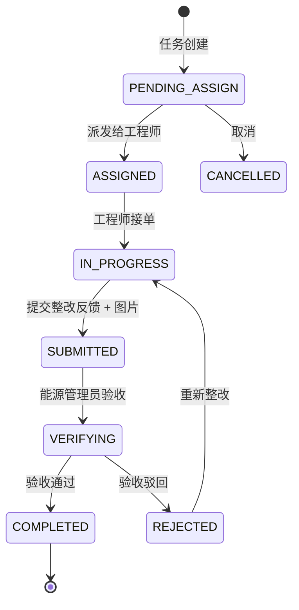
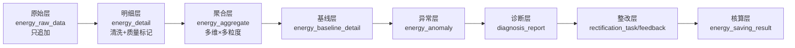

# 智能耗 · 架构设计文档

| 项 | 内容 |
| --- | --- |
| 文档版本 | v1.0（P0 设计阶段） |
| 适用系统 | 智能耗·工业企业能耗画像与节能诊断平台 |
| 关联文档 | [database-design.md](database-design.md)、[implementation-plan.md](implementation-plan.md)、[AGENTS.md](../AGENTS.md) |
| 读者 | 后端 / Web / 小程序开发、测试、运维 |

---

## 1. 设计目标与原则

### 1.1 目标

1. 支撑「采集 → 治理 → 画像 → 基线 → 异常 → 诊断 → 整改 → 核算」完整闭环，任何一环的数据都可回溯。
2. 单企业私有化部署可跑通，多企业（多租户）可按 `enterprise_id` 水平扩展。
3. 算法结果可解释：基线模型记录版本、参数、样本量与误差；异常记录触发证据；诊断记录规则快照。
4. 模块化单体：开发期部署简单，模块边界清晰，后续可按域拆分。

### 1.2 原则

| 原则 | 落地方式 |
| --- | --- |
| 数据一致性优先 | 跨表状态流转单事务；原始数据只追加；聚合/基线可重算且幂等 |
| 计算可追溯 | 模型版本、规则版本、工况快照随结果落库 |
| 不做伪实现 | 每个接口有真实实现与测试；未实现的返回明确错误而非假数据 |
| 边界清晰 | 模块间仅 Service 接口 + DTO 交互，禁止跨模块 Mapper |
| 默认安全 | 所有接口默认鉴权，白名单显式声明；企业数据隔离在服务端校验 |
| 渐进交付 | 按阶段交付可运行版本，每阶段都有可演示闭环 |

---

## 2. 总体架构

### 2.1 逻辑架构



### 2.2 部署架构



单机即可运行；生产建议：Nginx + 后端 2 实例（无状态，需共享文件存储）+ MySQL 主从。定时任务使用数据库锁或单实例执行，避免重复计算（P5 阶段引入 ShedLock 或 `sys_job_lock`）。

### 2.3 技术选型说明

| 关注点 | 方案 | 理由 |
| --- | --- | --- |
| 分层持久化 | MyBatis-Plus + 少量 XML | 单表 CRUD 高效，复杂统计走 XML 可控 |
| 鉴权 | Spring Security 6 + JWT | 无状态、适配小程序与 Web 两端 |
| 文档 | Springdoc OpenAPI | 与 Boot 3.2 原生兼容，可在线调试 |
| 三维 | Three.js | 浏览器端渲染产线布局，无需额外引擎 |
| 图表 | ECharts | 能耗曲线、基线对比、混淆矩阵展示 |
| 定时计算 | Spring `@Scheduled` + 数据库锁 | P0–P6 足够；数据量增大后迁移到独立任务进程 |

---

## 3. 模块划分

### 3.1 模块清单与职责

| 模块 | 职责 | 核心表 | 依赖 |
| --- | --- | --- | --- |
| `system` | 登录、用户、角色、权限、菜单、字典、操作日志 | sys_user、sys_role、sys_user_role | common |
| `masterdata` | 企业、车间、产线、设备、能源类型、仪表 | energy_enterprise、energy_workshop、energy_line、energy_device、energy_type、energy_meter | common |
| `datalake` | 采集接入、原始数据、清洗、明细、聚合、入库日志 | energy_raw_data、energy_detail、energy_aggregate、data_ingestion_log | masterdata |
| `profile` | 驾驶舱、能耗画像、三维工厂、对比分析 | 读取聚合与基线，不新增表 | datalake、baseline |
| `baseline` | 工况分析、动态基线训练/预测、偏差计算 | production_record、energy_baseline、energy_baseline_detail | datalake、masterdata |
| `diagnosis` | 异常识别、诊断规则、诊断报告 | energy_anomaly、diagnosis_rule、diagnosis_report | baseline、datalake |
| `rectification` | 整改任务、派发、小程序回填、状态流转 | rectification_task、rectification_feedback | diagnosis、system |
| `saving` | 节能效果核算、审核、追溯 | energy_saving_result | rectification、baseline |

### 3.2 依赖方向



约束：依赖只能沿箭头方向，禁止反向调用；`profile` 只读，不写入其他模块的表。

### 3.3 模块内部结构

```
com.smarten.module.<domain>
├── controller/     Controller，仅参数绑定 + 鉴权 + 调 Service
├── service/        IXxxService 接口
│   └── impl/       XxxServiceImpl，@Transactional 边界
├── mapper/         XxxMapper extends BaseMapper<Xxx>
├── entity/         Xxx 实体，继承 BaseEntity
├── dto/            XxxCreateDTO / XxxUpdateDTO / XxxQueryDTO
├── vo/             XxxVO / XxxDetailVO / XxxStatVO
├── converter/      XxxConverter（手写静态方法，避免过度引入）
├── enums/          模块枚举（状态、类型）
└── job/            定时任务（仅 baseline / diagnosis / datalake）
```

---

## 4. 核心业务流程

### 4.1 数据采集与入库



要点：
- 批次唯一键 `batch_no`，重复提交返回同一结果（幂等）。
- 原始值不做单位换算，换算在清洗阶段完成并记录换算系数。
- 单批次失败不回滚已入库数据，通过日志标记部分成功（`PARTIAL`）。

### 4.2 清洗与明细生成

1. 取 `energy_raw_data` 中 `clean_status = PENDING` 的数据。
2. 质量校验：范围校验（量程）、跳变校验（相邻点变化率）、缺失校验（时间连续性）。
3. 单位换算与倍率折算（`meter.ratio`）。
4. 写入 `energy_detail`，携带 `quality_flag`（`NORMAL` / `OUT_OF_RANGE` / `MISSING` / `INTERPOLATED` / `DUPLICATE`）。
5. 唯一键 `(meter_id, period_start, period_end)` + `INSERT ... ON DUPLICATE KEY UPDATE` 保证可重跑。

### 4.3 聚合

- 维度：企业 / 车间 / 产线 / 设备 × 能源类型 × 时间粒度（时、日、月）。
- 聚合仅使用 `quality_flag IN ('NORMAL','INTERPOLATED')` 的明细，并记录 `data_count`、`missing_count`。
- 唯一键 `(dim_type, dim_id, energy_type_id, period_type, period_start)`，可重算覆盖。
- 聚合任务按「日期 + 维度」分片，失败可单日重跑。

### 4.4 动态基线计算



### 4.5 异常识别与诊断



### 4.6 整改闭环



状态只能通过后端接口流转，每次流转写 `rectification_feedback`（动作流水），并校验当前状态合法性。

### 4.7 节能核算

1. 任务验收通过后生成核算单，锁定**整改前基线模型版本**与观察期（默认整改完成后 14 天，可配置）。
2. 用整改后工况参数代入整改前模型，得到「反事实基线」序列 `baseline_adj(t)`。
3. `saving = Σ(baseline_adj(t) − actual_after(t))`，仅统计质量为正常的时段。
4. 输出节能率、折合金额（按 `energy_type.price`）、置信度与样本天数。
5. 结果进入 `PENDING_AUDIT`，审核通过后生效；审核驳回需填写原因，可重新核算。

---

## 5. 核心算法设计

### 5.1 动态基线模型

**分析单元**：`设备 × 能源类型 × 粒度（DAY / SHIFT / HOUR）`。

**特征向量**：

| 特征 | 来源 | 处理 |
| --- | --- | --- |
| 产量 `output_qty` | production_record | 数值，标准化 |
| 运行时长 `run_minutes` | production_record | 分钟，标准化 |
| 负荷率 `load_rate` | production_record | 0–100，标准化 |
| 环境温度 `ambient_temp` | production_record | 数值 |
| 产品类型 `product_type` | production_record | one-hot |
| 班次 `shift` | production_record | one-hot（白/中/夜） |

**模型**：`E = β₀ + Σ βᵢ·xᵢ + ε`，最小二乘求解；特征共线时使用岭回归 `β = (XᵀX + λI)⁻¹Xᵀy`（λ 由交叉验证选取，默认 1e-3）。

**训练样本**：默认最近 90 天，剔除：
- `quality_flag != NORMAL` 的时段；
- 已确认异常（`energy_anomaly.status = CONFIRMED`）的时段；
- 停机、检修标记时段。

**准入与回退**（逐级降级，必须记录实际使用的层级）：

| 层级 | 条件 | 方法 |
| --- | --- | --- |
| L1 回归 | 样本 ≥ max(30, 5×特征数) 且 R² ≥ 0.6 且 MAPE ≤ 20% | 多变量线性回归 |
| L2 分组均值 | 工况分组（班次 × 负荷率区间 × 产品类型）样本 ≥ 10 | 组内均值 |
| L3 产线缩放 | 分组不足 | 产线同工况均值 × 设备历史占比系数 |
| L4 全局均值 | 以上均不足 | 全量正常样本均值，并标记 `LOW_CONFIDENCE` |

**模型记录**：`energy_baseline` 保存 `model_version`（如 `BL-20261104-0007`）、`algo`、`sample_count`、`r2`、`rmse`、`mape`、`params_json`（系数、截距、特征名、λ、分组表）、`feature_json`、`status`（DRAFT/ACTIVE/ARCHIVED）、生效区间。同一维度同一时刻只允许一个 ACTIVE 版本。

**预测**：每日定时为次日（或当日结束后）生成 `baseline_detail`；工况缺失时按上一有效工况填充并标记 `estimated = 1`。

### 5.2 偏差计算

```
deviation_rate = (actual - baseline) / baseline × 100
```

- 保留 4 位小数；`baseline` 为 0 或低于最小可比值时，偏差率置空并标记 `NOT_COMPARABLE`，同时记录绝对差值。
- 正偏差表示超基线用能，负偏差表示低于基线。

### 5.3 异常识别规则

| 类型 | 编码 | 判定要点 | 关键参数 |
| --- | --- | --- | --- |
| 能耗突增 | `SUDDEN_RISE` | 当前窗口偏差 > θ₁，且较前一窗口增幅 > δ | θ₁=30%，δ=20% |
| 持续高能耗 | `PERSISTENT_HIGH` | 连续 N 个窗口偏差 > θ₂ | N=3，θ₂=20% |
| 空载高能耗 | `IDLE_HIGH` | 负荷率 < 10% 或产量≈0，但能耗 > 空载基线 ×(1+θ₃) | θ₃=25% |
| 设备空转 | `IDLE_RUNNING` | 运行时长 > 0 且产量 = 0 持续 T 分钟 | T=30 |
| 单位产品能耗异常 | `UNIT_CONSUMPTION` | 单耗 > 同类工况均值 ×(1+θ₄) | θ₄=20% |
| 夜间异常耗能 | `NIGHT_ABNORMAL` | 非排班时段能耗 > 夜间基线 ×(1+θ₅) | θ₅=40%，22:00–06:00 |
| 能耗波动 | `VOLATILITY` | 窗口内变异系数 CV > θ₆ | θ₆=0.35 |
| 同类设备对比 | `PEER_COMPARE` | 同型号同工况 z-score > z₀ | z₀=2.5 |

实现约定：
- 阈值不硬编码，全部来自 `diagnosis_rule.threshold_json`，支持按企业覆盖。
- 每个检测器输出统一结构 `AnomalyCandidate(deviceId, type, periodStart, periodEnd, actual, baseline, deviation, severity, evidence)`。
- 同一设备同一窗口同类型去重；不同类型可并存但需在报告中合并展示。
- 严重级别：`LOW / MEDIUM / HIGH / CRITICAL`，由超限幅度与持续时长共同决定。

### 5.4 诊断引擎

- 规则结构：`rule_code`、`anomaly_type`、`condition_json`（条件树）、`weight`、`cause_template`、`suggestion_template`、`saving_formula`、`priority`、`version`、`enabled`。
- 条件树：`{ "logic": "AND", "children": [ { "field": "deviation_rate", "op": "GT", "value": 30 } ] }`，操作符支持 `GT/GE/LT/LE/EQ/NE/BETWEEN/IN`。
- **安全**：条件由解析器按白名单字段求值，禁止 SpEL、Groovy、JS 引擎执行用户输入，杜绝注入。
- 匹配：按 `anomaly_type` 取启用规则 → 条件求值 → 按 `priority` 与 `weight` 排序 → 取 Top N 作为原因候选。
- 输出：`conclusion`（结论模板渲染）、`cause_candidates`（含命中规则与贡献分）、`suggestions`、`estimated_saving`（按 `saving_formula` 的系数型公式计算：`系数 × 超限量 × 电价 × 预期改善率`）。
- 快照：报告落库时保存命中规则 JSON，规则后续修改不影响历史报告。

### 5.5 节能核算

核心公式（禁止使用整改前后总能耗直接相减）：

```
baseline_adj(t) = f_model(整改后工况(t))        # 整改前锁定的模型版本
saving          = Σ_t [ baseline_adj(t) - actual_after(t) ]   # t ∈ 正常时段
saving_rate     = saving / Σ_t baseline_adj(t) × 100%
saving_amount   = saving × price(energy_type)
```

要求：
- 观察期 ≥ 7 天（默认 14 天），且有效样本 ≥ 70%，否则结果标记 `INSUFFICIENT_DATA`。
- 剔除检修、停机、数据异常时段，保留剔除清单。
- 保存 `baseline_model_version`、`baseline_total`、`actual_total`、`method`、`sample_days`、`confidence`。
- 可追溯：任务 → 报告 → 规则版本 → 基线版本 → 反馈凭证，全链路可查。

---

## 6. 数据架构

### 6.1 分层



### 6.2 关键约束

- 所有能耗字段 `DECIMAL(18,4)`，金额 `DECIMAL(18,2)`，比率 `DECIMAL(9,4)`。
- 原始层唯一键 `(meter_id, collect_time, point_code)`，保证重复上报不重复入库。
- 明细/聚合/基线明细均设业务唯一键，支持 `ON DUPLICATE KEY UPDATE` 幂等重算。
- 业务表带 `enterprise_id` 并建索引，作为数据隔离与查询主维度。
- 逻辑删除 `deleted`，唯一索引包含 `deleted` 或采用「删除时置 deleted=id」方案规避唯一冲突（在 DDL 中统一约定）。

### 6.3 表清单

24 张表，详见 [database-design.md](database-design.md)：

- 系统域（3）：`sys_user`、`sys_role`、`sys_user_role`
- 主数据（6）：`energy_enterprise`、`energy_workshop`、`energy_line`、`energy_device`、`energy_type`、`energy_meter`
- 数据湖（4）：`energy_raw_data`、`energy_detail`、`energy_aggregate`、`data_ingestion_log`
- 工况与基线（3）：`production_record`、`energy_baseline`、`energy_baseline_detail`
- 诊断（3）：`energy_anomaly`、`diagnosis_rule`、`diagnosis_report`
- 整改与核算（3）：`rectification_task`、`rectification_feedback`、`energy_saving_result`

---

## 7. 接口设计规范

### 7.1 统一响应

```json
{
  "code": 200,
  "message": "success",
  "data": {},
  "timestamp": "2026-11-04 16:00:00",
  "traceId": "0f3c1a9e7b2d4c55"
}
```

分页数据统一：

```json
{
  "code": 200,
  "message": "success",
  "data": {
    "records": [],
    "total": 128,
    "pageNum": 1,
    "pageSize": 20,
    "pages": 7
  }
}
```

### 7.2 错误码

| 区间 | 含义 | 示例 |
| --- | --- | --- |
| 200 | 成功 | — |
| 400 | 参数校验失败 | `400` + 字段错误列表 |
| 401 | 未登录 / token 失效 | `401` |
| 403 | 无权限 | `403` |
| 404 | 资源不存在 | `404` |
| 409 | 状态冲突 / 唯一键冲突 | `409` |
| 500 | 系统异常 | `500` |
| 1xxx | 系统模块业务错误 | `1001` 用户名或密码错误 |
| 2xxx | 主数据 | `2001` 设备编码重复 |
| 3xxx | 数据湖 | `3001` 采集批次重复 |
| 4xxx | 基线 | `4001` 样本不足无法建模 |
| 5xxx | 诊断 | `5001` 规则条件非法 |
| 6xxx | 整改 | `6001` 非法状态流转 |
| 7xxx | 核算 | `7001` 观察期数据不足 |

### 7.3 通用约定

| 项 | 约定 |
| --- | --- |
| Base Path | `/api` |
| 资源命名 | 模块前缀（单数）+ 资源（复数），如 `/api/master/enterprises`、`/api/baseline/models`、`/api/diagnosis/anomalies` |
| 分页参数 | `pageNum`（从 1 开始）、`pageSize`（默认 20，最大 500）、`orderBy`、`asc` |
| 时间格式 | `yyyy-MM-dd HH:mm:ss`；日期参数 `yyyy-MM-dd` |
| 幂等 | 写操作可带 `Idempotency-Key`；采集批次以 `batchNo` 天然幂等 |
| 批量 | 单次批量 ≤ 1000 条，超出返回 400 |
| 文件 | `POST /api/files/upload`，返回 `fileId` 与访问 URL；限制 10MB，类型白名单 |
| 版本 | 无需 URL 版本号，破坏性变更走新路径并在进度文档登记 |

### 7.4 鉴权

- 请求头 `Authorization: Bearer <accessToken>`。
- 401 统一返回 JSON（不跳转 HTML），前端与小程序按 401 清理凭证并引导登录。
- 刷新令牌：`POST /api/auth/refresh`，refresh token 有效期 7 天。

---

## 8. 权限与安全设计

### 8.1 权限模型

RBAC：用户 → 角色 → 权限码。权限码 `<模块>:<资源>:<动作>`，如 `energy:baseline:calc`、`energy:task:assign`。

预置角色：

| 角色 | 权限范围 |
| --- | --- |
| `PLATFORM_ADMIN` | 全部 |
| `ENERGY_ADMIN` | 主数据、数据湖、基线、诊断、整改派发、核算审核 |
| `ENGINEER` | 小程序接口：我的任务、提交反馈、上传凭证 |
| `VIEWER` | 驾驶舱、画像、报表只读 |

### 8.2 安全要点

| 风险 | 措施 |
| --- | --- |
| SQL 注入 | MyBatis-Plus 参数绑定，禁止 `${}` 拼接；排序字段白名单校验 |
| 越权 | 服务端按 `enterprise_id` 校验资源归属；ID 直查必须带企业条件 |
| JWT 泄露 | 短有效期 + 可撤销（P2 引入 token 版本机制，届时同步更新库设计） |
| 密码 | BCrypt，强度校验，禁止明文日志 |
| 文件上传 | 类型白名单、大小限制、重命名存储、禁止路径穿越 |
| 表达式注入 | 诊断规则条件使用白名单字段解释器，禁用脚本引擎 |
| 接口滥用 | 登录与采集接口限流（P2 实现，基于本地令牌桶） |
| 敏感数据 | 手机号在列表页脱敏；日志脱敏 |

---

## 9. Web 前端架构

### 9.1 目录

```
web/src/
├── api/            # 按模块划分：auth.ts、enterprise.ts、energy.ts、baseline.ts ...
├── assets/
├── components/     # BaseChart、BaseTable、PageHeader、ThreeScene、StatusTag
├── layouts/        # DefaultLayout（侧边菜单 + 顶栏 + 面包屑）
├── router/         # index.ts、guard.ts、routes.ts
├── stores/         # user.ts、app.ts、dict.ts
├── styles/         # 变量、重置、Element Plus 主题覆盖
├── types/          # 全局类型定义
├── utils/          # request.ts、auth.ts、format.ts、validate.ts
└── views/          # 按模块分目录
```

### 9.2 请求链路

页面 → `api/xxx.ts` → `utils/request.ts`（拦截器：注入 token、统一错误、401 处理、loading 计数）→ 后端 `/api`。

响应拦截返回 `data` 字段；业务错误统一 `ElMessage.error`，401 清空用户态并跳登录。

### 9.3 路由与权限

- 静态路由：登录、404、403。
- 动态路由：登录后拉取 `/api/auth/menus` 生成，组件通过 `import.meta.glob` 映射。
- 守卫顺序：token 校验 → 用户信息加载 → 权限校验 → 标题设置。
- 按钮级权限指令 `v-perm="'energy:baseline:calc'"`。

### 9.4 页面清单（P3–P8 实现）

| 路由 | 页面 | 主要接口 |
| --- | --- | --- |
| `/dashboard` | 工业能源驾驶舱 | 总览统计、趋势、Top 排名 |
| `/master/enterprise` | 企业管理 | 企业 CRUD |
| `/master/workshop` | 车间管理 | 车间 CRUD |
| `/master/line` | 产线管理 | 产线 CRUD |
| `/master/device` | 设备管理 | 设备 CRUD |
| `/master/energy` | 能源管理 | 能源类型、仪表、单价 |
| `/datalake` | 数据湖管理 | 原始数据、明细、聚合、入库日志 |
| `/profile` | 能耗画像 | 多维画像、单耗、对比 |
| `/factory-3d` | 三维工厂 | 产线布局与设备状态 |
| `/baseline` | 动态基线管理 | 基线列表、模型详情、重算 |
| `/diagnosis` | 异常诊断中心 | 异常列表、诊断报告 |
| `/rules` | 诊断规则管理 | 规则 CRUD、启停、试算 |
| `/tasks` | 整改任务中心 | 任务派发、跟踪、验收 |
| `/saving` | 节能效果分析 | 核算单、趋势、审核 |
| `/system/user` | 用户权限管理 | 用户、角色、菜单 |

### 9.5 状态与体验

- 列表页统一封装 `useTable`（分页、查询、重置、loading、空态、错误重试）。
- 图表统一 `BaseChart`，`option` 由页面根据接口数据构造。
- 全局 loading 与请求错误提示，避免重复弹窗。

---

## 10. 小程序架构

```
miniprogram/
├── app.js / app.json / app.wxss
├── utils/
│   ├── config.js      # baseUrl、超时、版本
│   ├── request.js     # 封装 wx.request / wx.uploadFile，统一 Result 解包
│   ├── auth.js        # token 存取、过期判断、登录跳转
│   ├── upload.js      # 图片选择、压缩、上传
│   └── format.js      # 时间、数值格式化
├── components/        # 任务卡片、状态标签、空态、图片预览
└── pages/
    ├── login/         # 账号密码登录
    ├── workbench/     # 待办统计、快捷入口
    ├── anomaly/       # 列表 + 详情
    ├── task/          # 列表 + 详情 + 反馈
    └── mine/          # 个人信息、退出
```

约束：
- 所有请求经 `request.js`，自动带 token；401 统一 `auth.clear()` 并 `reLaunch` 到登录页。
- 任务状态展示以服务端返回为准；提交反馈后重新拉取详情。
- 图片先 `wx.chooseMedia` → `upload.js` 压缩（质量 0.7）→ 上传拿 `fileId` → 随反馈提交。
- 分页：`pageNum/pageSize`，下拉刷新重置为 1。

---

## 11. 非功能设计

### 11.1 性能

| 场景 | 目标 | 手段 |
| --- | --- | --- |
| 列表查询 | P95 < 300ms | 覆盖索引、避免 `SELECT *`、强制分页 |
| 聚合日报 | 单日单企业 < 10s | 批量 SQL、按天分片、避免循环单条查询 |
| 基线训练 | 单设备 < 2s | 内存矩阵运算、样本窗口上限 180 天 |
| 驾驶舱 | 首屏 < 2s | 预聚合表 + 缓存 60s |
| 采集入库 | 1000 点 < 1s | 批量插入、唯一键去重 |

### 11.2 日志与可观测

- 日志：`logs/smarten.log`（INFO）、`logs/error.log`（ERROR），按天滚动保留 30 天。
- 请求链路：`traceId` 写入 MDC，响应体与日志同时输出。
- 慢 SQL：MyBatis 拦截器记录 > 500ms 的语句。
- 健康检查：`/actuator/health`（放行）。

### 11.3 数据与备份

- MySQL 每日全备 + binlog 增量；保留 30 天。
- 原始数据归档策略：18 个月前数据转历史表（P9 考虑）。
- 重算工具：按日期区间对明细/聚合/基线重跑，并在 `data_ingestion_log` 留痕。

### 11.4 时区与编码

- 全链路 `Asia/Shanghai`；JVM 启动参数 `-Duser.timezone=Asia/Shanghai`。
- 数据库 `utf8mb4` / `utf8mb4_0900_ai_ci`。

---

## 12. 验收指标的技术口径

| 指标 | 计算方式 | 产出 |
| --- | --- | --- |
| 入库完整率 ≥ 99% | 按批次：`valid_count / expected_count`；按周期：`Σvalid / Σexpected` | `data_ingestion_log` + 统计接口 |
| 异常识别率 ≥ 90% | 独立标注测试集（真实标注 + 合成注入），按窗口二分类计算 Recall | 评估脚本输出 Precision / Recall / F1 / 混淆矩阵（CSV + 页面） |
| 基线按工况修正 | 回归系数随工况变化；不同班次/负荷率基线不同 | 模型详情页展示系数、样本量、误差、分组表 |
| 节能可核算可追溯 | 反事实基线 − 实际，链路留存版本与凭证 | 核算单详情含模型版本、观察期、剔除记录、审核流 |

测试集构造（P6 交付）：
1. 从历史数据中人工标注 ≥ 200 个窗口（异常/正常），覆盖 8 类异常。
2. 在正常数据上按规则注入合成异常（幅度、持续时间可控），标签精确已知。
3. 固定随机种子，脚本可复现；评估结果随版本归档。

---

## 13. 风险与应对

| 风险 | 影响 | 应对 |
| --- | --- | --- |
| 工况数据缺失导致基线失真 | 诊断误报 | 缺失工况标记 `estimated`，降低置信度；样本不足自动回退 |
| 异常样本不均衡 | Recall 虚高或虚低 | 分类型评估 + 阈值可调；报告同时给 Precision |
| 多企业数据隔离遗漏 | 数据泄露 | 统一 `enterprise_id` 拦截器 + 越权单测 |
| 重算任务重复执行 | 数据重复/错乱 | 业务唯一键 + 数据库任务锁 |
| 文件存储单点 | 凭证丢失 | 生产接对象存储，本地目录仅开发用 |
| 小程序审核与版本 | 上线延迟 | 提前准备类目与隐私协议，接口向后兼容 |

---

## 14. 演进路线

1. **P1–P4**：单体 + 模块内分层，先保证闭环可跑。
2. **P5–P7**：算法与诊断增强，引入模型评估与规则试算。
3. **P8–P9**：多租户细化、任务调度独立、报表导出。
4. **后续**：数据量增大后，将 `datalake` 聚合与 `baseline` 训练拆为独立计算服务，通过消息队列解耦；数据库按企业分库。
