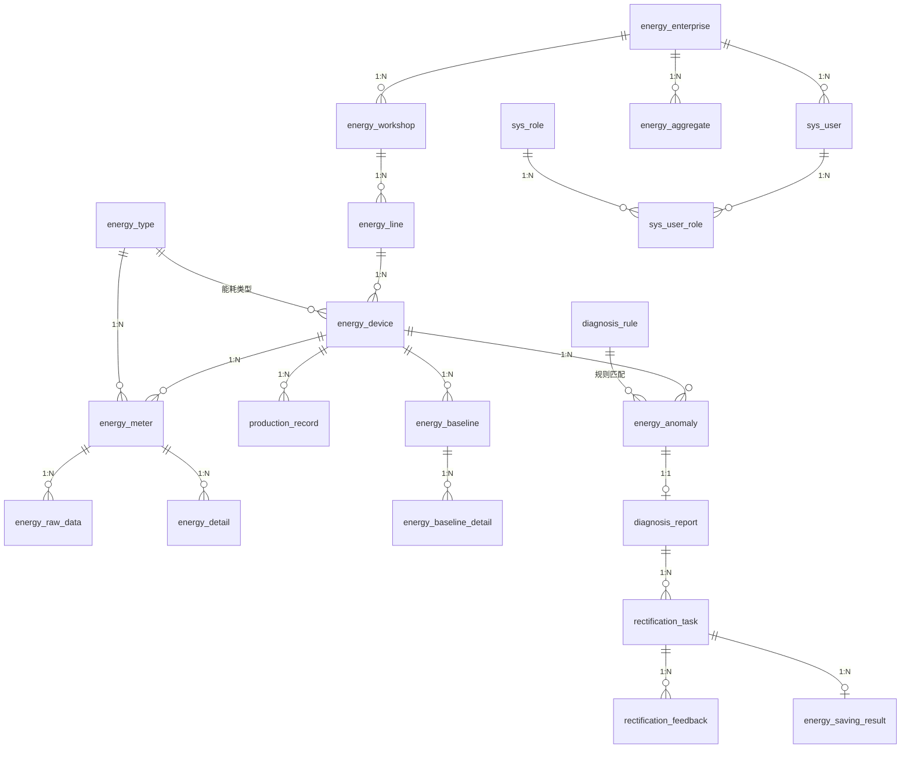

# 智能耗 · 数据库设计

| 项 | 内容 |
| --- | --- |
| 数据库 | MySQL 8.0+ |
| 库名 | `smarten_energy` |
| 字符集 | `utf8mb4` / `utf8mb4_0900_ai_ci` |
| 引擎 | InnoDB |
| 时区 | 连接参数 `serverTimezone=Asia/Shanghai` |
| 版本 | v1.0（P0 设计阶段，P1 落地为 DDL） |

---

## 1. 设计约定

### 1.1 命名

- 表名：小写下划线，业务域前缀（`sys_`、`energy_`、`data_`、`production_`、`rectification_`）。
- 字段名：小写下划线；布尔含义用 `TINYINT`（0/1）；状态用 `TINYINT` + 字典。
- 索引：`uk_<表缩写>_<字段>`、`idx_<表缩写>_<字段>`，如 `uk_meter_code`、`idx_task_assignee_status`。

### 1.2 公共字段

除关联表外，所有表包含：

| 字段 | 类型 | 说明 |
| --- | --- | --- |
| `id` | `BIGINT` PK AUTO_INCREMENT | 主键 |
| `create_time` | `DATETIME` NOT NULL DEFAULT CURRENT_TIMESTAMP | 创建时间 |
| `update_time` | `DATETIME` NOT NULL DEFAULT CURRENT_TIMESTAMP ON UPDATE CURRENT_TIMESTAMP | 更新时间 |
| `create_by` | `BIGINT` NULL | 创建人 |
| `update_by` | `BIGINT` NULL | 更新人 |
| `deleted` | `TINYINT` NOT NULL DEFAULT 0 | 逻辑删除：0 正常，1 已删除 |

**逻辑删除约定**：业务编码（企业/设备/表计编码、批次号等）**全局唯一且删除后不可复用**，因此唯一索引不包含 `deleted`。若后续需要复用编码，改为 `deleted BIGINT`（删除时写入主键）并将唯一索引改为 `(code, deleted)`，须先提交设计变更。

### 1.3 数据类型

| 用途 | 类型 | 说明 |
| --- | --- | --- |
| 能耗量 | `DECIMAL(18,4)` | kWh / m³ / t，禁止 FLOAT/DOUBLE |
| 金额 | `DECIMAL(18,2)` | 元 |
| 比率/偏差 | `DECIMAL(9,4)` | 百分数存数值，12.3456 表示 12.3456% |
| 单价 | `DECIMAL(12,4)` | 元/kWh 等 |
| R² | `DECIMAL(9,6)` | 0–1 |
| 时间 | `DATETIME` | 秒级；统计周期用 `period_start`/`period_end` 左闭右开 |
| 结构化扩展 | `JSON` | 模型参数、证据、快照、凭证列表 |
| 长文本 | `VARCHAR(1000)` / `TEXT` | 结论、建议、反馈内容 |

### 1.4 完整性策略

- 主数据层级使用**逻辑外键**（不建物理外键，便于分库与批量导入），外键列建索引，由应用层保证一致性，并提供巡检 SQL。
- 统计与流水表靠**业务唯一键**保证幂等：重复采集/重算使用 `INSERT ... ON DUPLICATE KEY UPDATE`。
- 状态流转由应用层校验，禁止直接 UPDATE 状态字段（除管理端补偿接口）。

---

## 2. 表清单（24 张）

| # | 表名 | 域 | 说明 |
| --- | --- | --- | --- |
| 1 | `sys_user` | 系统 | 用户 |
| 2 | `sys_role` | 系统 | 角色 |
| 3 | `sys_user_role` | 系统 | 用户角色关联 |
| 4 | `energy_enterprise` | 主数据 | 企业 |
| 5 | `energy_workshop` | 主数据 | 车间 |
| 6 | `energy_line` | 主数据 | 产线 |
| 7 | `energy_device` | 主数据 | 设备 |
| 8 | `energy_type` | 主数据 | 能源类型与单价 |
| 9 | `energy_meter` | 主数据 | 计量仪表 |
| 10 | `energy_raw_data` | 数据湖 | 原始采集数据 |
| 11 | `energy_detail` | 数据湖 | 清洗后能耗明细 |
| 12 | `energy_aggregate` | 数据湖 | 多维能耗聚合 |
| 13 | `data_ingestion_log` | 数据湖 | 采集入库日志 |
| 14 | `production_record` | 工况 | 生产工况记录 |
| 15 | `energy_baseline` | 基线 | 动态基线模型 |
| 16 | `energy_baseline_detail` | 基线 | 基线明细与偏差 |
| 17 | `energy_anomaly` | 诊断 | 异常事件 |
| 18 | `diagnosis_rule` | 诊断 | 诊断规则 |
| 19 | `diagnosis_report` | 诊断 | 诊断报告 |
| 20 | `rectification_task` | 整改 | 整改任务 |
| 21 | `rectification_feedback` | 整改 | 整改反馈与验收流水 |
| 22 | `energy_saving_result` | 核算 | 节能核算结果 |
| 23 | `data_ingest_failure` | 数据湖 | 入库失败记录 |
| 24 | `energy_data_gap` | 数据湖 | 数据缺口与补录 |

---

## 3. ER 关系



---

## 4. 表结构

### 4.1 `sys_user` 用户

| 字段 | 类型 | 空 | 说明 |
| --- | --- | --- | --- |
| `username` | `VARCHAR(64)` | N | 登录名，唯一 |
| `password` | `VARCHAR(100)` | N | BCrypt 密文 |
| `real_name` | `VARCHAR(64)` | Y | 姓名 |
| `phone` | `VARCHAR(20)` | Y | 手机号，列表脱敏 |
| `email` | `VARCHAR(128)` | Y | 邮箱 |
| `avatar` | `VARCHAR(255)` | Y | 头像 URL |
| `enterprise_id` | `BIGINT` | Y | 所属企业；平台管理员为 NULL |
| `status` | `TINYINT` | N | 1 启用 / 0 禁用，默认 1 |
| `last_login_time` | `DATETIME` | Y | 最后登录时间 |
| `last_login_ip` | `VARCHAR(64)` | Y | 最后登录 IP |
| `remark` | `VARCHAR(255)` | Y | 备注 |

索引：`uk_user_username(username)`、`idx_user_enterprise(enterprise_id)`、`idx_user_phone(phone)`。

### 4.2 `sys_role` 角色

| 字段 | 类型 | 空 | 说明 |
| --- | --- | --- | --- |
| `role_code` | `VARCHAR(64)` | N | 角色编码，唯一 |
| `role_name` | `VARCHAR(64)` | N | 角色名称 |
| `description` | `VARCHAR(255)` | Y | 描述 |
| `permissions` | `VARCHAR(2000)` | N | 权限码，逗号分隔；`*` 表示全部（登录时展开） |
| `sort_no` | `INT` | N | 排序，默认 0 |
| `status` | `TINYINT` | N | 1 启用 / 0 禁用 |
| `builtin` | `TINYINT` | N | 1 内置角色不可删除 |

索引：`uk_role_code(role_code)`。

### 4.3 `sys_user_role` 用户角色

| 字段 | 类型 | 空 | 说明 |
| --- | --- | --- | --- |
| `user_id` | `BIGINT` | N | 用户 ID |
| `role_id` | `BIGINT` | N | 角色 ID |

索引：`uk_user_role(user_id, role_id)`、`idx_ur_role(role_id)`。

### 4.4 `energy_enterprise` 企业

| 字段 | 类型 | 空 | 说明 |
| --- | --- | --- | --- |
| `code` | `VARCHAR(64)` | N | 企业编码，唯一 |
| `name` | `VARCHAR(128)` | N | 企业名称 |
| `industry` | `VARCHAR(64)` | Y | 所属行业 |
| `region` | `VARCHAR(64)` | Y | 所在地区 |
| `address` | `VARCHAR(255)` | Y | 详细地址 |
| `contact_name` | `VARCHAR(64)` | Y | 联系人 |
| `contact_phone` | `VARCHAR(20)` | Y | 联系电话 |
| `status` | `TINYINT` | N | 1 正常 / 0 停用 |
| `remark` | `VARCHAR(255)` | Y | 备注 |

索引：`uk_ent_code(code)`、`idx_ent_name(name)`。

### 4.5 `energy_workshop` 车间

| 字段 | 类型 | 空 | 说明 |
| --- | --- | --- | --- |
| `enterprise_id` | `BIGINT` | N | 所属企业 |
| `code` | `VARCHAR(64)` | N | 车间编码（企业内唯一） |
| `name` | `VARCHAR(128)` | N | 车间名称 |
| `manager` | `VARCHAR(64)` | Y | 车间负责人 |
| `area` | `DECIMAL(12,2)` | Y | 面积（㎡） |
| `status` | `TINYINT` | N | 1 正常 / 0 停用 |
| `remark` | `VARCHAR(255)` | Y | 备注 |

索引：`uk_ws_ent_code(enterprise_id, code)`、`idx_ws_enterprise(enterprise_id)`。

### 4.6 `energy_line` 产线

| 字段 | 类型 | 空 | 说明 |
| --- | --- | --- | --- |
| `enterprise_id` | `BIGINT` | N | 所属企业（冗余，便于隔离查询） |
| `workshop_id` | `BIGINT` | N | 所属车间 |
| `code` | `VARCHAR(64)` | N | 产线编码（企业内唯一） |
| `name` | `VARCHAR(128)` | N | 产线名称 |
| `product_type` | `VARCHAR(64)` | Y | 主要产品类型 |
| `design_capacity` | `DECIMAL(18,4)` | Y | 设计产能 |
| `capacity_unit` | `VARCHAR(16)` | Y | 产能单位 |
| `status` | `TINYINT` | N | 1 正常 / 0 停用 |
| `remark` | `VARCHAR(255)` | Y | 备注 |

索引：`uk_line_ent_code(enterprise_id, code)`、`idx_line_workshop(workshop_id)`。

### 4.7 `energy_device` 设备

| 字段 | 类型 | 空 | 说明 |
| --- | --- | --- | --- |
| `enterprise_id` | `BIGINT` | N | 所属企业 |
| `workshop_id` | `BIGINT` | N | 所属车间 |
| `line_id` | `BIGINT` | N | 所属产线 |
| `code` | `VARCHAR(64)` | N | 设备编码（企业内唯一） |
| `name` | `VARCHAR(128)` | N | 设备名称 |
| `device_type` | `VARCHAR(64)` | N | 设备类型（如空压机/注塑机） |
| `model` | `VARCHAR(64)` | Y | 型号，用于同类对比分组 |
| `rated_power` | `DECIMAL(12,4)` | Y | 额定功率 kW |
| `energy_type_id` | `BIGINT` | Y | 主要能源类型 |
| `commission_date` | `DATE` | Y | 投运日期 |
| `status` | `TINYINT` | N | 1 运行 / 2 停机 / 3 检修 / 0 停用 |
| `remark` | `VARCHAR(255)` | Y | 备注 |

索引：`uk_dev_ent_code(enterprise_id, code)`、`idx_dev_line(line_id)`、`idx_dev_type(enterprise_id, device_type, model)`、`idx_dev_status(status)`。

### 4.8 `energy_type` 能源类型

| 字段 | 类型 | 空 | 说明 |
| --- | --- | --- | --- |
| `code` | `VARCHAR(32)` | N | 编码：ELEC/WATER/GAS/STEAM/AIR，唯一 |
| `name` | `VARCHAR(64)` | N | 名称：电/水/天然气/蒸汽/压缩空气 |
| `unit` | `VARCHAR(16)` | N | 计量单位：kWh/m³/t |
| `price` | `DECIMAL(12,4)` | N | 参考单价（元/单位），默认 0 |
| `co2_factor` | `DECIMAL(12,4)` | Y | 碳排放因子 |
| `coal_factor` | `DECIMAL(12,4)` | N | 折标煤系数（kgce/单位） |
| `status` | `TINYINT` | N | 1 启用 / 0 停用 |

索引：`uk_et_code(code)`。

### 4.9 `energy_meter` 计量仪表

| 字段 | 类型 | 空 | 说明 |
| --- | --- | --- | --- |
| `enterprise_id` | `BIGINT` | N | 所属企业 |
| `device_id` | `BIGINT` | Y | 绑定设备；为空表示产线/车间总表 |
| `line_id` | `BIGINT` | Y | 绑定产线（总表时使用） |
| `meter_code` | `VARCHAR(64)` | N | 仪表编号，全局唯一 |
| `meter_name` | `VARCHAR(128)` | N | 仪表名称 |
| `energy_type_id` | `BIGINT` | N | 能源类型 |
| `ratio` | `DECIMAL(12,4)` | N | 倍率（互感器/脉冲系数），默认 1 |
| `collect_interval_seconds` | `INT` | N | 采集间隔（秒），用于推算应采点数，默认 60 |
| `reading_type` | `TINYINT` | N | 读数类型：1 累计读数 / 2 周期增量 |
| `install_time` | `DATETIME` | Y | 安装时间 |
| `status` | `TINYINT` | N | 1 正常 / 0 停用 |
| `remark` | `VARCHAR(255)` | Y | 备注 |

索引：`uk_meter_code(meter_code)`、`idx_meter_device(device_id)`、`idx_meter_line(line_id)`、`idx_meter_enterprise(enterprise_id, energy_type_id)`。

### 4.10 `energy_raw_data` 原始采集数据

| 字段 | 类型 | 空 | 说明 |
| --- | --- | --- | --- |
| `enterprise_id` | `BIGINT` | N | 所属企业 |
| `meter_id` | `BIGINT` | N | 仪表 ID |
| `device_id` | `BIGINT` | Y | 冗余设备 ID，便于按设备查询 |
| `collect_time` | `DATETIME` | N | 采集时间点 |
| `point_code` | `VARCHAR(64)` | N | 点位编码，默认 `TOTAL` |
| `raw_value` | `DECIMAL(18,4)` | N | 原始读数（未换算） |
| `raw_unit` | `VARCHAR(16)` | Y | 原始单位 |
| `reading_type` | `TINYINT` | N | 读数类型：1 累计读数 / 2 周期增量 |
| `received_time` | `DATETIME` | Y | 接收时间 |
| `quality` | `TINYINT` | N | 1 正常 / 2 可疑 / 3 无效 |
| `source` | `VARCHAR(32)` | N | GATEWAY / IMPORT / MANUAL / API |
| `batch_no` | `VARCHAR(64)` | N | 采集批次号 |
| `clean_status` | `TINYINT` | N | 0 待清洗 / 1 已清洗 / 2 已忽略 |
| `ext_json` | `JSON` | Y | 原始报文扩展字段 |

索引：`uk_raw_meter_point_time(meter_id, collect_time, point_code)`、`idx_raw_time(collect_time)`、`idx_raw_batch(batch_no)`、`idx_raw_clean(clean_status, collect_time)`。

> 唯一键保证同一仪表同一时刻同一点位只入库一次，重复上报直接忽略并计入日志。

### 4.11 `energy_detail` 能耗明细

| 字段 | 类型 | 空 | 说明 |
| --- | --- | --- | --- |
| `enterprise_id` | `BIGINT` | N | 所属企业 |
| `meter_id` | `BIGINT` | N | 仪表 ID |
| `device_id` | `BIGINT` | Y | 设备 ID |
| `line_id` | `BIGINT` | Y | 产线 ID |
| `energy_type_id` | `BIGINT` | N | 能源类型 |
| `period_start` | `DATETIME` | N | 区间开始（含） |
| `period_end` | `DATETIME` | N | 区间结束（不含） |
| `energy_value` | `DECIMAL(18,4)` | N | 折算后能耗量 |
| `unit` | `VARCHAR(16)` | N | 单位 |
| `start_reading` | `DECIMAL(18,4)` | Y | 区间起始读数（累计表） |
| `end_reading` | `DECIMAL(18,4)` | Y | 区间结束读数（累计表） |
| `quality_flag` | `TINYINT` | N | 1 正常 / 2 越界 / 3 缺失补全 / 4 重复 / 5 人工修正 |
| `estimated` | `TINYINT` | N | 是否补录估算：1 是 |
| `source_count` | `INT` | N | 参与计算的原始点数 |
| `calc_version` | `VARCHAR(32)` | Y | 清洗算法版本 |
| `remark` | `VARCHAR(255)` | Y | 备注 |

索引：`uk_detail_meter_period(meter_id, period_start, period_end)`、`idx_detail_device_period(device_id, period_start)`、`idx_detail_ent_period(enterprise_id, period_start)`、`idx_detail_quality(quality_flag)`。

### 4.12 `energy_aggregate` 能耗聚合

| 字段 | 类型 | 空 | 说明 |
| --- | --- | --- | --- |
| `enterprise_id` | `BIGINT` | N | 所属企业 |
| `dim_type` | `TINYINT` | N | 1 企业 / 2 车间 / 3 产线 / 4 设备 |
| `dim_id` | `BIGINT` | N | 维度对象 ID |
| `energy_type_id` | `BIGINT` | N | 能源类型 |
| `period_type` | `TINYINT` | N | 1 小时 / 2 日 / 3 月 |
| `period_start` | `DATETIME` | N | 周期开始 |
| `energy_value` | `DECIMAL(18,4)` | N | 聚合能耗 |
| `cost_amount` | `DECIMAL(18,2)` | Y | 折算金额 |
| `data_count` | `INT` | N | 参与聚合的有效明细数 |
| `missing_count` | `INT` | N | 缺失时段数 |
| `calc_version` | `VARCHAR(32)` | Y | 聚合版本 |

索引：`uk_agg_dim_period(dim_type, dim_id, energy_type_id, period_type, period_start)`、`idx_agg_ent_period(enterprise_id, period_type, period_start)`、`idx_agg_period(period_start)`。

### 4.13 `data_ingestion_log` 采集入库日志

| 字段 | 类型 | 空 | 说明 |
| --- | --- | --- | --- |
| `batch_no` | `VARCHAR(64)` | N | 批次号，唯一 |
| `enterprise_id` | `BIGINT` | Y | 企业；全局批次可为空 |
| `meter_id` | `BIGINT` | Y | 单表批次；批量导入为空 |
| `data_date` | `DATE` | N | 数据归属日期 |
| `source` | `VARCHAR(32)` | N | 来源 |
| `expected_count` | `INT` | N | 应采点数 |
| `received_count` | `INT` | N | 实收点数 |
| `valid_count` | `INT` | N | 有效点数 |
| `missing_count` | `INT` | N | 缺失点数 |
| `success_rate` | `DECIMAL(9,4)` | N | 有效/应收 ×100 |
| `status` | `TINYINT` | N | 0 进行中 / 1 成功 / 2 部分成功 / 3 失败 |
| `error_msg` | `VARCHAR(1000)` | Y | 错误摘要 |
| `start_time` | `DATETIME` | Y | 开始时间 |
| `end_time` | `DATETIME` | Y | 结束时间 |

索引：`uk_log_batch(batch_no)`、`idx_log_ent_date(enterprise_id, data_date)`、`idx_log_status(status)`。

> 入库完整率 = `SUM(valid_count) / SUM(expected_count) × 100%`（可按企业、日期、批次聚合）。

### 4.14 `production_record` 生产工况

| 字段 | 类型 | 空 | 说明 |
| --- | --- | --- | --- |
| `enterprise_id` | `BIGINT` | N | 所属企业 |
| `workshop_id` | `BIGINT` | Y | 车间 |
| `line_id` | `BIGINT` | Y | 产线 |
| `device_id` | `BIGINT` | Y | 设备；产线级记录可为空 |
| `record_date` | `DATE` | N | 生产日期 |
| `shift` | `TINYINT` | N | 1 白班 / 2 中班 / 3 夜班 |
| `start_time` | `DATETIME` | N | 班次开始 |
| `end_time` | `DATETIME` | N | 班次结束 |
| `product_type` | `VARCHAR(64)` | Y | 产品类型 |
| `output_qty` | `DECIMAL(18,4)` | N | 产量，默认 0 |
| `output_unit` | `VARCHAR(16)` | Y | 产量单位 |
| `run_minutes` | `INT` | N | 运行时长（分钟），默认 0 |
| `load_rate` | `DECIMAL(5,2)` | Y | 负荷率 0–100 |
| `ambient_temp` | `DECIMAL(6,2)` | Y | 环境温度 ℃ |
| `status` | `TINYINT` | N | 1 正常 / 2 停机 / 3 检修 |
| `data_source` | `VARCHAR(32)` | Y | MES / MANUAL / IMPORT |

索引：`uk_prod_device_shift(device_id, start_time, shift)`、`idx_prod_line_date(line_id, record_date)`、`idx_prod_ent_date(enterprise_id, record_date)`。

> 该表是基线回归的工况输入，缺失时基线自动降级并标记置信度。

### 4.15 `energy_baseline` 动态基线模型

| 字段 | 类型 | 空 | 说明 |
| --- | --- | --- | --- |
| `enterprise_id` | `BIGINT` | N | 所属企业 |
| `dim_type` | `TINYINT` | N | 3 产线 / 4 设备 |
| `dim_id` | `BIGINT` | N | 维度对象 ID |
| `energy_type_id` | `BIGINT` | N | 能源类型 |
| `granularity` | `TINYINT` | N | 1 日 / 2 班次 / 3 小时 |
| `baseline_type` | `TINYINT` | N | 1 回归 / 2 分组均值 / 3 产线缩放 / 4 全局均值 |
| `model_version` | `VARCHAR(64)` | N | 模型版本号，如 `BL-20261104-0007` |
| `algo` | `VARCHAR(32)` | Y | OLS / RIDGE / GROUP_MEAN |
| `sample_count` | `INT` | N | 训练样本数 |
| `train_start` | `DATE` | Y | 训练窗口开始 |
| `train_end` | `DATE` | Y | 训练窗口结束 |
| `r2` | `DECIMAL(9,6)` | Y | 决定系数 |
| `rmse` | `DECIMAL(18,4)` | Y | 均方根误差 |
| `mape` | `DECIMAL(9,4)` | Y | 平均绝对百分比误差 |
| `params_json` | `JSON` | Y | 系数、截距、λ、分组均值表 |
| `feature_json` | `JSON` | Y | 特征顺序与标准化参数 |
| `confidence` | `TINYINT` | N | 1 高 / 2 中 / 3 低 |
| `status` | `TINYINT` | N | 0 草稿 / 1 生效 / 2 归档 |
| `effective_from` | `DATETIME` | Y | 生效时间 |
| `effective_to` | `DATETIME` | Y | 失效时间 |
| `calc_time` | `DATETIME` | Y | 计算完成时间 |

索引：`uk_bl_dim_version(dim_type, dim_id, energy_type_id, granularity, model_version)`、`idx_bl_dim_status(dim_type, dim_id, status)`、`idx_bl_ent(enterprise_id, granularity)`。

> 同一维度同一粒度同一时刻仅允许一个 `status = 1` 的记录，由应用层在事务内先归档旧版本再激活新版本。

### 4.16 `energy_baseline_detail` 基线明细

| 字段 | 类型 | 空 | 说明 |
| --- | --- | --- | --- |
| `baseline_id` | `BIGINT` | N | 基线模型 ID |
| `enterprise_id` | `BIGINT` | N | 所属企业 |
| `dim_type` | `TINYINT` | N | 维度类型 |
| `dim_id` | `BIGINT` | N | 维度 ID |
| `energy_type_id` | `BIGINT` | N | 能源类型 |
| `period_start` | `DATETIME` | N | 周期开始 |
| `period_end` | `DATETIME` | N | 周期结束 |
| `baseline_value` | `DECIMAL(18,4)` | N | 基线预测值 |
| `actual_value` | `DECIMAL(18,4)` | Y | 实际能耗 |
| `deviation_value` | `DECIMAL(18,4)` | Y | 绝对偏差 |
| `deviation_rate` | `DECIMAL(9,4)` | Y | 偏差率（%） |
| `estimated` | `TINYINT` | N | 1 表示工况缺失推算 |
| `comparable` | `TINYINT` | N | 1 可比较 / 0 基线不可比 |
| `computed_at` | `DATETIME` | Y | 计算时间 |

索引：`uk_bld_baseline_period(baseline_id, period_start)`、`idx_bld_dim_period(dim_type, dim_id, period_start)`、`idx_bld_ent_period(enterprise_id, period_start)`。

### 4.17 `energy_anomaly` 异常事件

| 字段 | 类型 | 空 | 说明 |
| --- | --- | --- | --- |
| `enterprise_id` | `BIGINT` | N | 所属企业 |
| `workshop_id` | `BIGINT` | Y | 车间 |
| `line_id` | `BIGINT` | Y | 产线 |
| `device_id` | `BIGINT` | N | 设备 |
| `anomaly_type` | `VARCHAR(32)` | N | 8 类异常编码 |
| `severity` | `TINYINT` | N | 1 低 / 2 中 / 3 高 / 4 严重 |
| `period_start` | `DATETIME` | N | 异常区间开始 |
| `period_end` | `DATETIME` | N | 异常区间结束 |
| `actual_value` | `DECIMAL(18,4)` | Y | 实际值 |
| `baseline_value` | `DECIMAL(18,4)` | Y | 基线值 |
| `deviation_rate` | `DECIMAL(9,4)` | Y | 偏差率 |
| `threshold_value` | `DECIMAL(18,4)` | Y | 触发阈值 |
| `rule_code` | `VARCHAR(64)` | Y | 命中检测规则 |
| `evidence_json` | `JSON` | Y | 证据（序列、相邻窗口、同类对比） |
| `detect_time` | `DATETIME` | N | 检出时间 |
| `detect_batch` | `VARCHAR(64)` | Y | 检测批次号 |
| `status` | `TINYINT` | N | 0 待确认 / 1 已确认 / 2 误报 / 3 已转诊断 / 4 已关闭 |
| `confirm_by` | `BIGINT` | Y | 确认人 |
| `confirm_time` | `DATETIME` | Y | 确认时间 |
| `remark` | `VARCHAR(500)` | Y | 说明 |

索引：`uk_ano_device_type_period(device_id, anomaly_type, period_start)`、`idx_ano_ent_detect(enterprise_id, detect_time)`、`idx_ano_status(status)`、`idx_ano_type(anomaly_type)`、`idx_ano_device_period(device_id, period_start)`。

### 4.18 `diagnosis_rule` 诊断规则

| 字段 | 类型 | 空 | 说明 |
| --- | --- | --- | --- |
| `rule_code` | `VARCHAR(64)` | N | 规则编码，唯一 |
| `rule_name` | `VARCHAR(128)` | N | 规则名称 |
| `anomaly_type` | `VARCHAR(32)` | N | 适用异常类型 |
| `condition_json` | `JSON` | N | 条件树（白名单字段求值） |
| `threshold_json` | `JSON` | Y | 阈值参数，支持企业覆盖 |
| `weight` | `DECIMAL(5,2)` | N | 权重，用于候选排序 |
| `cause_template` | `VARCHAR(500)` | y | 原因模板 |
| `suggestion_template` | `VARCHAR(1000)` | Y | 整改建议模板 |
| `saving_formula` | `VARCHAR(255)` | Y | 节能量估算公式（系数型） |
| `priority` | `INT` | N | 优先级，默认 100 |
| `version` | `INT` | N | 版本号，每次修改 +1 |
| `enabled` | `TINYINT` | N | 1 启用 / 0 停用 |
| `enterprise_id` | `BIGINT` | Y | 为空表示全局规则 |
| `remark` | `VARCHAR(255)` | Y | 备注 |

索引：`uk_rule_code(rule_code)`、`idx_rule_type_enabled(anomaly_type, enabled)`、`idx_rule_ent(enterprise_id)`。

> 条件由后端解释器解析，禁止 SpEL / Groovy / JS 执行，防止表达式注入。

### 4.19 `diagnosis_report` 诊断报告

| 字段 | 类型 | 空 | 说明 |
| --- | --- | --- | --- |
| `report_no` | `VARCHAR(64)` | N | 报告编号，唯一 |
| `enterprise_id` | `BIGINT` | N | 所属企业 |
| `anomaly_id` | `BIGINT` | N | 关联异常 |
| `device_id` | `BIGINT` | N | 设备 |
| `baseline_id` | `BIGINT` | Y | 使用的基线模型 |
| `model_version` | `VARCHAR(64)` | Y | 基线模型版本快照 |
| `conclusion` | `VARCHAR(1000)` | N | 诊断结论 |
| `cause_candidates_json` | `JSON` | Y | 原因候选（含规则、得分） |
| `suggestions_json` | `JSON` | Y | 整改建议列表 |
| `estimated_saving` | `DECIMAL(18,4)` | Y | 预计节能量 |
| `rule_snapshot_json` | `JSON` | Y | 命中规则快照 |
| `status` | `TINYINT` | N | 0 待处理 / 1 已转任务 / 2 已关闭 |
| `generated_at` | `DATETIME` | N | 生成时间 |

索引：`uk_report_no(report_no)`、`idx_report_anomaly(anomaly_id)`、`idx_report_ent_time(enterprise_id, generated_at)`。

### 4.20 `rectification_task` 整改任务

| 字段 | 类型 | 空 | 说明 |
| --- | --- | --- | --- |
| `task_no` | `VARCHAR(64)` | N | 任务编号，唯一 |
| `report_id` | `BIGINT` | Y | 来源诊断报告 |
| `anomaly_id` | `BIGINT` | Y | 来源异常 |
| `enterprise_id` | `BIGINT` | N | 所属企业 |
| `line_id` | `BIGINT` | Y | 产线 |
| `device_id` | `BIGINT` | Y | 设备 |
| `title` | `VARCHAR(200)` | N | 任务标题 |
| `content` | `TEXT` | Y | 任务描述与整改要求 |
| `priority` | `TINYINT` | N | 1 低 / 2 中 / 3 高 / 4 紧急 |
| `assignee_id` | `BIGINT` | Y | 负责人（工程师） |
| `assignee_name` | `VARCHAR(64)` | Y | 负责人姓名快照 |
| `assign_time` | `DATETIME` | Y | 派发时间 |
| `deadline` | `DATETIME` | Y | 截止时间 |
| `status` | `TINYINT` | N | 0 待派发 / 1 已派发 / 2 整改中 / 3 待验收 / 4 已完成 / 5 已驳回 / 6 已取消 |
| `source` | `TINYINT` | N | 1 自动 / 2 手工 |
| `baseline_snapshot_json` | `JSON` | Y | 整改前基线快照 |
| `finish_time` | `DATETIME` | Y | 完成时间 |
| `remark` | `VARCHAR(500)` | Y | 备注 |

索引：`uk_task_no(task_no)`、`idx_task_assignee(assignee_id, status)`、`idx_task_ent_status(enterprise_id, status)`、`idx_task_device(device_id)`、`idx_task_report(report_id)`。

### 4.21 `rectification_feedback` 整改反馈

| 字段 | 类型 | 空 | 说明 |
| --- | --- | --- | --- |
| `task_id` | `BIGINT` | N | 整改任务 |
| `feedback_type` | `TINYINT` | N | 1 进度 / 2 完工 / 3 验收 / 4 驳回 |
| `content` | `VARCHAR(1000)` | Y | 反馈内容 |
| `images_json` | `JSON` | Y | 凭证文件列表（fileId、url） |
| `actual_saving` | `DECIMAL(18,4)` | Y | 工程师自估节能量 |
| `submit_by` | `BIGINT` | N | 提交人 |
| `submit_time` | `DATETIME` | N | 提交时间 |
| `verify_by` | `BIGINT` | Y | 验收人 |
| `verify_time` | `DATETIME` | Y | 验收时间 |
| `verify_result` | `TINYINT` | Y | 1 通过 / 2 驳回 |
| `verify_remark` | `VARCHAR(500)` | Y | 验收意见 |

索引：`idx_fb_task(task_id, submit_time)`、`idx_fb_type(feedback_type)`。

### 4.22 `energy_saving_result` 节能核算结果

| 字段 | 类型 | 空 | 说明 |
| --- | --- | --- | --- |
| `task_id` | `BIGINT` | N | 整改任务 |
| `report_id` | `BIGINT` | Y | 诊断报告 |
| `enterprise_id` | `BIGINT` | N | 所属企业 |
| `device_id` | `BIGINT` | Y | 设备 |
| `version` | `INT` | N | 核算版本（重算 +1） |
| `verify_start` | `DATETIME` | N | 观察期开始 |
| `verify_end` | `DATETIME` | N | 观察期结束 |
| `sample_days` | `INT` | N | 有效样本天数 |
| `method` | `TINYINT` | N | 1 反事实基线法（默认）/ 2 对比法（仅参考） |
| `baseline_model_version` | `VARCHAR(64)` | N | 锁定的基线模型版本 |
| `baseline_total` | `DECIMAL(18,4)` | N | 反事实基线总量 |
| `actual_total` | `DECIMAL(18,4)` | N | 整改后实际总量 |
| `saving_value` | `DECIMAL(18,4)` | N | 节能量 |
| `saving_rate` | `DECIMAL(9,4)` | Y | 节能率 % |
| `saving_amount` | `DECIMAL(18,2)` | Y | 折合金额 |
| `confidence` | `TINYINT` | N | 1 高 / 2 中 / 3 低 |
| `excluded_json` | `JSON` | Y | 剔除时段与原因 |
| `status` | `TINYINT` | N | 0 待审核 / 1 已生效 / 2 已驳回 |
| `audited_by` | `BIGINT` | Y | 审核人 |
| `audited_at` | `DATETIME` | Y | 审核时间 |
| `audit_remark` | `VARCHAR(500)` | Y | 审核意见 |

索引：`uk_save_task_version(task_id, version)`、`idx_save_ent_time(enterprise_id, verify_start)`、`idx_save_status(status)`。

> 节能核算只允许使用「反事实基线 − 实际」口径；`method = 2` 仅作对比参考，不得作为验收依据。

### 4.23 `data_ingest_failure` 入库失败记录

| 字段 | 类型 | 空 | 说明 |
| --- | --- | --- | --- |
| `batch_no` | `VARCHAR(64)` | N | 批次号 |
| `enterprise_id` | `BIGINT` | Y | 所属企业 |
| `meter_id` | `BIGINT` | Y | 仪表 ID |
| `collect_time` | `DATETIME` | Y | 采集时间 |
| `payload` | `TEXT` | Y | 原始提交内容（保留不丢） |
| `error_code` | `VARCHAR(32)` | N | 错误码，如 METER_NOT_FOUND / IMPORT_PARSE |
| `error_msg` | `VARCHAR(500)` | Y | 失败原因 |
| `retry_count` | `INT` | N | 重试次数 |
| `status` | `TINYINT` | N | 0 待处理 / 1 已补录 / 2 已忽略 |

索引：`idx_fail_batch(batch_no)`、`idx_fail_meter_time(meter_id, collect_time)`、`idx_fail_status(status)`。

### 4.24 `energy_data_gap` 数据缺口

| 字段 | 类型 | 空 | 说明 |
| --- | --- | --- | --- |
| `enterprise_id` | `BIGINT` | N | 所属企业 |
| `meter_id` | `BIGINT` | N | 仪表 ID |
| `energy_type_id` | `BIGINT` | Y | 能源类型 |
| `gap_start` | `DATETIME` | N | 缺口开始 |
| `gap_end` | `DATETIME` | N | 缺口结束（不含） |
| `expected_count` | `INT` | N | 应采点数 |
| `actual_count` | `INT` | N | 实采点数 |
| `missing_count` | `INT` | N | 缺失点数 |
| `status` | `TINYINT` | N | 0 待补录 / 1 已补录 / 2 已忽略 |
| `fill_time` | `DATETIME` | Y | 补录时间 |
| `remark` | `VARCHAR(255)` | Y | 备注 |

索引：`idx_gap_meter_time(meter_id, gap_start)`、`idx_gap_status(status)`、`idx_gap_ent(enterprise_id)`。

> 补录数据以 `source = BACKFILL`、`quality = 2` 写入 ODS，并在 DWD 标记 `quality_flag = 3`、`estimated = 1`，原始数据不被覆盖或删除。

---

## 5. 关键查询与索引验证

| 查询场景 | SQL 特征 | 依赖索引 |
| --- | --- | --- |
| 某设备某日能耗曲线 | `device_id = ? AND period_start BETWEEN ? AND ?` | `idx_detail_device_period` |
| 驾驶舱企业日趋势 | `enterprise_id = ? AND period_type = 2 AND period_start >= ?` | `idx_agg_ent_period` |
| 待办任务列表 | `assignee_id = ? AND status IN (...)` | `idx_task_assignee` |
| 异常中心按时间筛选 | `enterprise_id = ? ORDER BY detect_time DESC` | `idx_ano_ent_detect` |
| 采集完整率统计 | `data_date = ? GROUP BY enterprise_id` | `idx_log_ent_date` |
| 基线明细回放 | `baseline_id = ? ORDER BY period_start` | `uk_bld_baseline_period` |
| 同类设备对比 | `device_type = ? AND model = ?` | `idx_dev_type` |

---

## 6. 枚举字典

| 枚举 | 值 |
| --- | --- |
| 通用状态 | 0 停用 / 1 启用 |
| 设备状态 | 0 停用 / 1 运行 / 2 停机 / 3 检修 |
| 能源类型 | ELEC 电 / WATER 水 / GAS 天然气 / STEAM 蒸汽 / AIR 压缩空气 |
| 数据质量 | 1 正常 / 2 越界 / 3 缺失补全 / 4 重复 / 5 人工修正 |
| 采集状态 | 0 进行中 / 1 成功 / 2 部分成功 / 3 失败 |
| 聚合维度 | 1 企业 / 2 车间 / 3 产线 / 4 设备 |
| 时间粒度 | 1 小时 / 2 日 / 3 月（基线为 1 日 / 2 班次 / 3 小时） |
| 基线类型 | 1 回归 / 2 分组均值 / 3 产线缩放 / 4 全局均值 |
| 基线状态 | 0 草稿 / 1 生效 / 2 归档 |
| 异常类型 | SUDDEN_RISE / PERSISTENT_HIGH / IDLE_HIGH / IDLE_RUNNING / UNIT_CONSUMPTION / NIGHT_ABNORMAL / VOLATILITY / PEER_COMPARE |
| 严重级别 | 1 低 / 2 中 / 3 高 / 4 严重 |
| 异常状态 | 0 待确认 / 1 已确认 / 2 误报 / 3 已转诊断 / 4 已关闭 |
| 报告状态 | 0 待处理 / 1 已转任务 / 2 已关闭 |
| 任务状态 | 0 待派发 / 1 已派发 / 2 整改中 / 3 待验收 / 4 已完成 / 5 已驳回 / 6 已取消 |
| 反馈类型 | 1 进度 / 2 完工 / 3 验收 / 4 驳回 |
| 核算状态 | 0 待审核 / 1 已生效 / 2 已驳回 |

---

## 7. 初始化与迁移约定

### 7.1 P1 交付物

```
backend/src/main/resources/db/
├── schema.sql      # 24 张表 DDL（含索引、注释）
├── data.sql        # 预置数据：角色、管理员、能源类型、演示企业
└── README.md       # 执行顺序与账号说明
```

### 7.2 预置数据

| 数据 | 内容 |
| --- | --- |
| 角色 | `PLATFORM_ADMIN`、`ENERGY_ADMIN`、`ENGINEER`、`VIEWER` |
| 管理员 | `admin` / 初始密码通过环境变量注入，首次登录强制修改 |
| 能源类型 | ELEC/kWh、WATER/m³、GAS/m³、STEAM/t、AIR/m³ |
| 演示企业 | 1 家企业 + 2 车间 + 3 产线 + 若干设备与表计（P2 补充） |

### 7.3 变更管理

- 禁止直接改已上线的 `schema.sql`；新增变更走 `db/migration/V<版本>__<说明>.sql`（P1 起启用 Flyway 或手工版本目录）。
- 每次表结构变更必须同步更新本文档，并在 `docs/development-progress.md` 记录。
- 删除字段/表前先确认无引用，采用「先停用、再观察、后删除」三步走。
